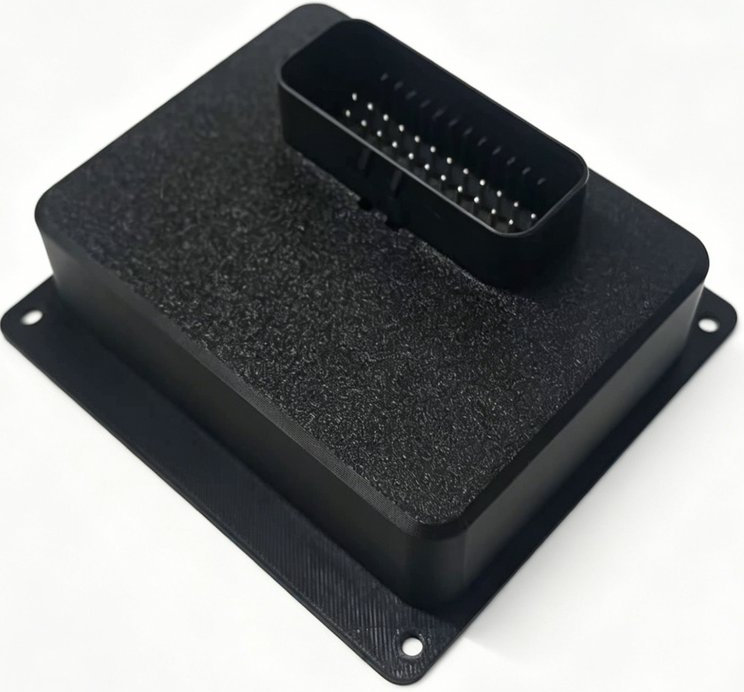
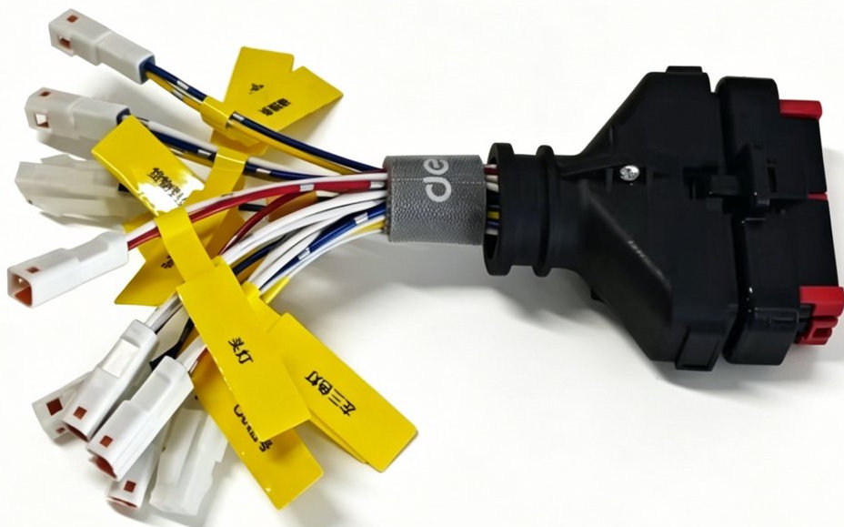
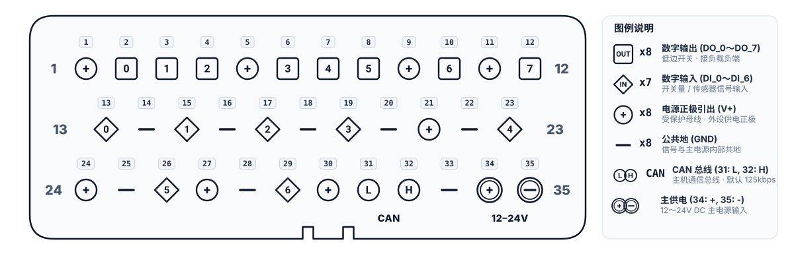

# CAN IO 控制盒规格书

## 产品外观与配套线束

<ImageRow>

</ImageRow>

## 产品概述

CAN IO 控制盒是一款通过 CAN 总线扩展数字量输入输出的控制盒。
控制盒采集数字量输入、驱动数字量输出，并通过 CAN 总线与主机通信。
对外仅通过一个 35 针主接口走线，电源、CAN 与外设信号均经配套线束引出。

## 规格

<!-- prettier-ignore -->
| 项目 | 值 | 描述 |
| --- | --- | --- |
| **供电电压** | 12～24V DC | 主电源输入范围 |
| **数字输入 DI** | 7 路 | 连接开关或传感器 |
| **数字输出 DO** | 8 路 | 低边开关输出，负载正端接电源，负端接对应 DO 线 |
| **单路输出电流** | 2A | 每个 DO 通道的负载电流上限 |
| **输出总电流** | 5A | 所有 DO 通道同时工作的电流合计上限 |
| **CAN 波特率** | 125 kbit/s | 默认值，需与主机 CAN 配置一致 |

## 接口说明

控制盒的 **35 针主接口**汇集电源、CAN 和数字量输入输出信号。
下表按连接器电气针号说明，外设端按配套线束标签接线。
插合面与焊接面的观察方向不同，请按针号定位。

<!-- prettier-ignore -->
| 功能 | 针号 | 说明 |
| --- | --- | --- |
| **电源** | **34**（正极）、**35**（负极） | 接 12～24V DC 主电源，负极与公共地共地 |
| **CAN 总线** | **31**（CAN_L）、**32**（CAN_H） | 接主机 CAN 通信总线，默认波特率 125 kbit/s |
| **输入 (DI)** | **13** (DI_0)、**15** (DI_1)、**17** (DI_2)、**19** (DI_3)、**23** (DI_4)、**26** (DI_5)、**29** (DI_6) | 共 7 路数字输入，接开关量或传感器信号 |
| **输出 (DO)** | **2** (DO_0)、**3** (DO_1)、**4** (DO_2)、**6** (DO_3)、**7** (DO_4)、**8** (DO_5)、**10** (DO_6)、**12** (DO_7) | 共 8 路低边开关输出，负载正极接电源，负极接 DO |
| **IO 电源 (V+)** | **1、5、9、11、21、24、27、30** | 共用受保护的电源母线，用于配套外设及传感器供电正极 |
| **IO 地 (GND)** | **14、16、18、20、22、25、28、33** | 公共地；供外设回路就近接地，内部与系统共地 |

## 安装与使用

1. 断电后，用外壳安装孔将控制盒固定在目标位置。
2. 插接配套线束并锁紧，按上述针号连接电源和 CAN，按线束标签连接开关、传感器及负载。
3. 上电后确认状态灯闪烁，在主机端逐路检查输入状态和输出负载动作。
