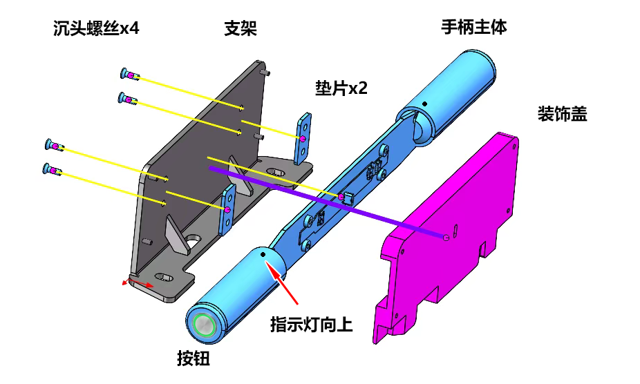
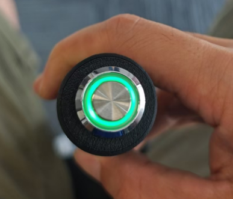
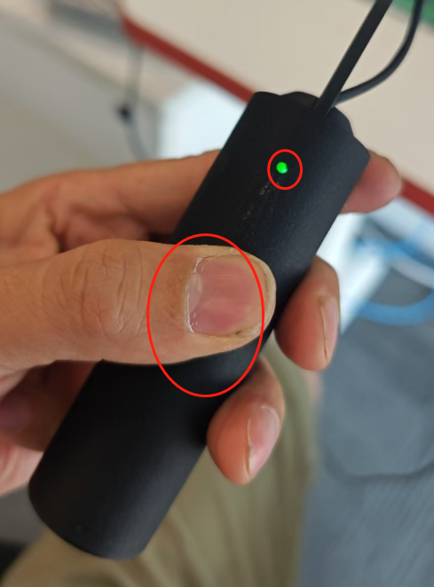

# 压敏推行手柄规格书

## 功能简介

压敏推行手柄（Push Handle）采集两路模拟信号、两路触摸状态和一个按键状态，通过串口持续发送给上位机。
上位机可设置指示灯显示方式、触发两路外部复位控制，并读写设备参数。

## 规格参数

<!-- prettier-ignore -->
| 项目 | 规格 |
| --- | --- |
| **模拟输入** | 2 路，输出 ADC 原始整数读数 |
| **触摸输入** | 2 路，上拉输入，低电平有效 |
| **按键输入** | 1 路，上拉输入，低电平有效 |
| **指示灯控制** | 常亮、熄灭、慢闪、快闪，以及上电后的本地显示逻辑 |
| **外部复位控制** | 2 路，可分别或同时输出约 300ms 高电平脉冲 |
| **通信接口** | 固件 `Serial`，初始化波特率 115200 bps |
| **状态上报周期** | `push`、`btn` 每轮各一帧，标称约 50ms；`ver` 每 10 轮一帧，标称约 500ms |
| **设备标识** | 可读取 12 位大写十六进制 MAC 地址 |
| **参数存储** | NVS 非易失存储，字符串键值形式 |

## 散件手柄组装

## 检查

以下检查用于确认通电后的按钮和触摸指示灯状态。
用 USB Type-C 线连接手柄，通过 USB 充电头或电脑供电；检查时先不要启动会设置手柄灯光状态的上位机程序。

<!-- prettier-ignore -->
| 检查项 | 操作 | 预期结果 |
| --- | --- | --- |
| **通电状态** | 接通 USB 电源，不按按钮 | 按钮绿灯亮 |
| **按钮响应** | 按下按钮 | 按钮绿灯熄灭 |
| **左侧触摸** | 用手触摸左侧握持部位 | 左侧对应的小绿灯亮 |
| **右侧触摸** | 用手触摸右侧握持部位 | 右侧对应的小绿灯亮 |

<ImageRow>

</ImageRow>

装配完成后，按组装示意图确认指示灯朝上，并重复上述通电检查。
