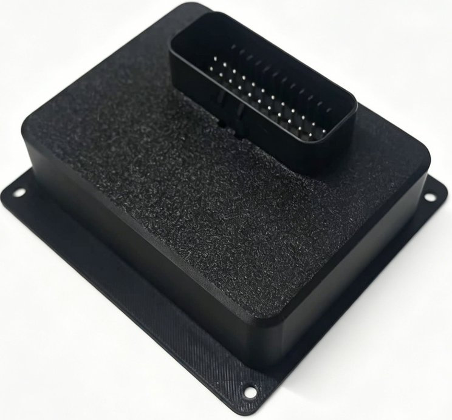
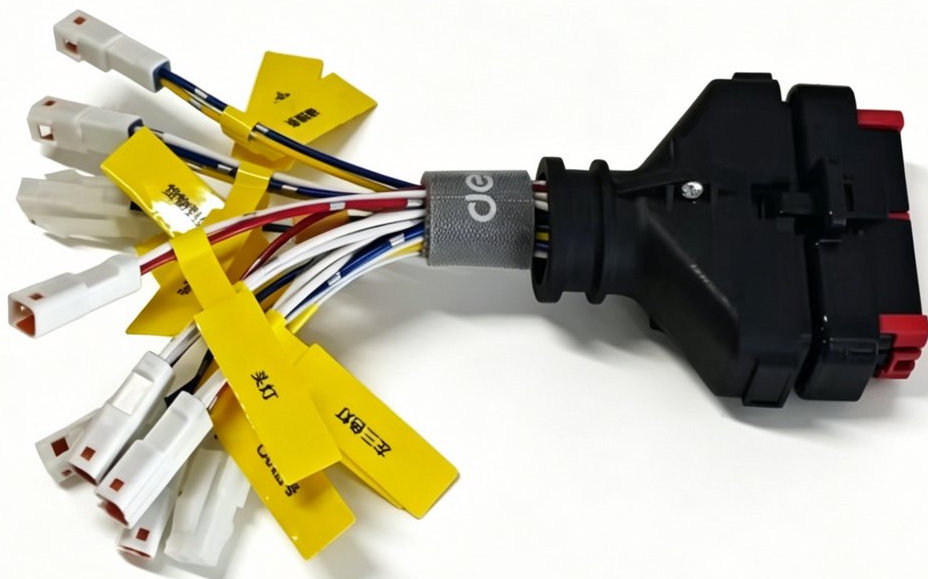
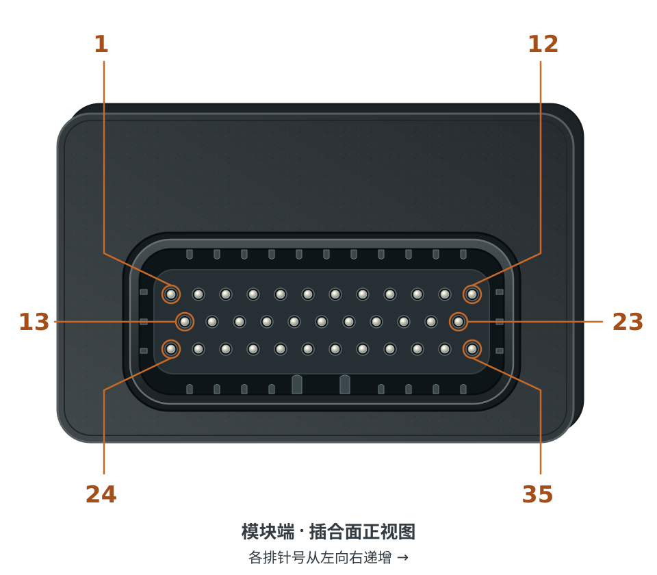

# CAN IO 板规格书

## 产品外观与配套线束

<ImageRow>

</ImageRow>

## 产品概述

IO 模块由 **HC32F460 IO 控制板**与**线束转接板**配套插接组成。
控制板负责数字量输入采集、输出控制及 CAN 通信，转接板负责外设线束转接。
安装和接线时，两块板作为一套组件使用。

## 规格

<!-- prettier-ignore -->
| 项目 | 描述 |
| --- | --- |
| **供电电压** | 12～24V DC |
| **数字输入 DI** | 7 路，连接开关或传感器 |
| **数字输出 DO** | 8 路低边开关输出，负载正端接电源，负端接对应 DO 线 |
| **通信接口** | CAN；默认 125 kbit/s |
| **接线方式** | 两板配套插接，通过配套线束连接电源、主机与外设 |

## 接口说明

控制板的 **35 针主接口**汇集电源、CAN 和数字量输入输出信号。
下表按连接器电气针号说明；转接板外设端按配套线束标签接线。
插合面与焊接面的观察方向不同，请按针号定位。

<!-- prettier-ignore -->
| 针号 | 功能 | 说明 |
| --- | --- | --- |
| **34** | 电源输入正极 | 接 12～24V DC 电源正极 |
| **14、16、18、20、22、25、28、33、35** | GND | 公共地；电源、输入输出及 CAN 通信共地 |
| **31** | CAN_L | 接主机 CANL |
| **32** | CAN_H | 接主机 CANH |
| **13、15、17、19、23、26、29** | DI_0～DI_6 | 按所列针号依次对应 7 路输入 |
| **2、3、4、6、7、8、10、12** | DO_0～DO_7 | 按所列针号依次对应 8 路低边输出 |
| **1、5、9、11、21、24、27、30** | 电源正极引出 | 共用受保护的电源母线，用于配套外设供电 |

## 安装与使用

1. 断电后，将配套的控制板与转接板对正插接并固定，通过外壳安装孔固定整套模块。
2. 插接配套线束并锁紧，按上述针号连接电源和 CAN，按线束标签连接开关、传感器及负载。
3. 上电后确认状态灯闪烁，在主机端逐路检查输入状态和输出负载动作。
