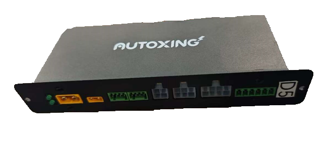
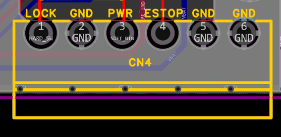

# 24V 电源控制盒说明书

## 规格

| 项目 | 描述 |
| :--- | :--- |
| **输入电压** | 12-30V |
| **2x3P 12V 输出** | 额定 6A，保护电流 7-8A |
| **2x2P 5V 输出** | 额定 3.5A (含短路保护。长期过流有 170 度过热保护。) |
| **2x4P 输出** | R1-R6: 20A 慢断保险丝 R7 开始: 电子保险丝，跳闸电流 41A (长鸣 3 秒表示有短路) |
| **过热保护 (R7 开始)** | 总线 MOS 附近有温度传感器，超过 100 度会自动关机。持续输出 30A 较长时间可触发。 |

## 端子说明

接线端子从左往右，分别为：

| 端子 | 功能 | 说明 |
| :--- | :--- | :--- |
| **XT60** | 总电源输入 | 接电池。支持电压 12-30V。 |
| **XT30** | 充电输入 | 接充电桩。充电电流小于 10A |
| **2.54mm 4P (串口)** | 电池通讯串口 | 接电池 BMS。线序从左往右：3.3V, TX, RX, GND 端子型号：DB2ERC-2.54-4P-GN |
| **2.54mm 4P (CAN)** | CAN 总线接口 | 接算力盒 CAN 总线。线序从左往右：空端子, CANH, CANL, 空端子 端子型号：DB2ERC-2.54-4P-GN |
| **2x2P** | 5V 输出 & LED 灯带 | 左上：5V+ 右上：2812b 彩色灯带输出 左下、右下：GND |
| **2x3P** | 稳压 12V 输出 | 上正、下负 |
| **2x4P** | 直通供电输出 | 电压和总电源输入一致。 **最左边 (正负一对)**: 最普通，通过 MOS 直接连电池。额定电流10A。 **中间两对**: 必须给轮子，内置防反压功能。当轮子发电 (下坡、推行) 导致电压升高到 32V 左右时会主动切断。建议使用专门制作的轮子线材。内置电流采样。额定电流 20A。 **最右边一组**: 内置电流采样，通常用于接顶升电机。额定电流 10A。 |

## 3.81mm 6P 开关、急停按钮

从左到右，依次为：

| 引脚 | 功能 | 说明 |
| :--- | :--- | :--- |
| **1** | 锁定 | 和 GND 相连后，断开电源 |
| **2** | GND | |
| **3** | 软开关 | 和 GND 相连后，短按开机，长按关机 |
| **4** | 急停 | 和 GND 相连后触发急停 (或反逻辑，断开后触发，软件可配) |
| **5** | GND | |
| **6** | GND | |

## 版本差异

电源盒经过多轮改版，不同批次的硬件能力有实际差别。
板上丝印的 `R1`、`R7`、`R12` 等编号即硬件版本号（软件也可通过 ADC 读取版本号）。
下表按版本汇总对使用方有意义的主要变化。

<!-- prettier-ignore -->
| 版本 | 主要差异 |
| :--- | :--- |
| **R1 - R6** | 2x4P 直通输出使用传统 20A 慢断保险丝。 没有过热保护。 带独立的硬开关按钮，硬开关优先于软开关。 |
| **R7** | 2x4P 输出引入电子保险丝，跳闸电流 41A，并新增总线 MOS 附近的过热保护（超 100 度关机）。 |
| **R8 - R9** | 电子保险丝方案稳定下来，可通过短路测试（需配合 33nF Timer 电容）。 R9 后期把分压电阻 `R6` 改为 499kΩ，解决"推一下机身就关机"的问题。 |
| **R10** | 主控换为 HC32F460。 **取消硬开关按钮**，只保留软开关 + 急停。 简化软开关逻辑，去掉光耦。 彩色灯带 2812 去掉高速光耦。 总开关 MOS 换为 MX10T01AHTL，降低大电流下的温度。 |
| **R11** | 防反压 TVS 由 36V 降为 33V。 3.3V 输入增加独立 SMF30A 保护。 总开关 MOS 增加 SD12C 保护。 **调大启动功率，改善拖挂车型启动瞬间的大电流导致的误判短路。** |
| **R12** | 电子保险丝采样电阻由 1.33mΩ 改为 1mΩ，**过流保护提升到50-60A**。 温度传感器移到靠近轮子的位置。 |

### 选型与替换注意

- **输出保护方式不同**：R6 及之前是传统慢断保险丝，R7 起是电子保险丝。
  两者"跳闸"后的恢复方式不同：电子保险丝会自动恢复，慢断保险丝需更换。
- **R10 起没有硬开关**：老机箱上的硬开关按钮在新版本上不再生效，只能使用软开关。
- **额定值有差异**：R11, R12 起，开机启动功率更大，总电流能力更强；

