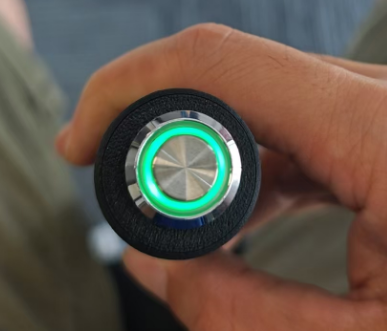
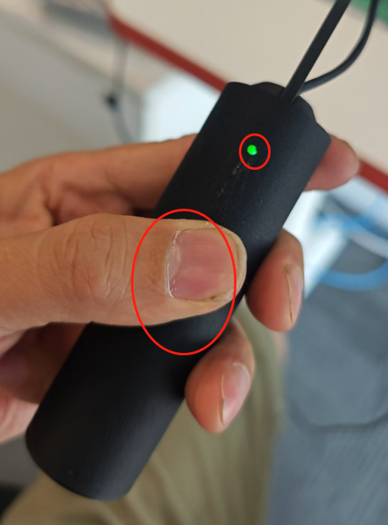
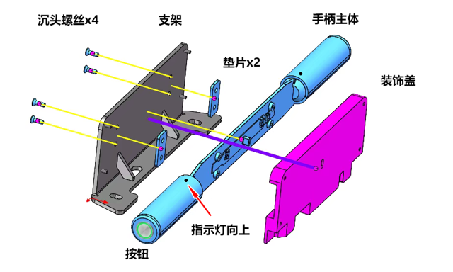

# 助力推行手柄规格书

## 功能简介

助力推行手柄（Push Handle）是机器人的推行配件，随机器人本体交付。
手柄通过 USB Type-C 线直接接入机器人，一根线同时完成供电与通讯，插上即可使用，无需外部电源或额外配置。

手柄顶部设有按钮，左右握持部位各设一处触摸区。
按钮与触摸状态由机器人读取，机器人通过手柄上的指示灯反馈当前状态。

## 规格参数

<!-- prettier-ignore -->
| 项目 | 值 | 说明 |
| --- | --- | --- |
| **供电电压** | 5V DC | 由机器人 USB 接口供电，无需外部电源 |
| **供电电流** | 0.5A | 手柄自身消耗电流上限 |
| **对外接口** | USB Type-C | 一根线同时完成供电与通讯，插上即用，免驱免配置 |
| **按钮** | 1 个 | 位于手柄顶部，按下时按钮指示灯熄灭 |
| **触摸区** | 2 处 | 左右握持部位各一处，触摸时对应侧指示灯亮起 |
| **指示灯** | 3 组 | 按钮指示灯 1 组，左右握持指示灯各 1 组 |

## 通电检查

以下检查用于确认通电后的按钮和触摸指示灯状态。
用 USB Type-C 线把手柄接到机器人的 USB 接口；检查时先不要启动会设置手柄灯光状态的机器人端程序。

<!-- prettier-ignore -->
| 检查项 | 操作 | 预期结果 |
| --- | --- | --- |
| **通电状态** | 接通 USB 电源，不按按钮 | 按钮绿灯亮 |
| **按钮响应** | 按下按钮 | 按钮绿灯熄灭 |
| **左侧触摸** | 用手触摸左侧握持部位 | 左侧对应的小绿灯亮 |
| **右侧触摸** | 用手触摸右侧握持部位 | 右侧对应的小绿灯亮 |

<ImageRow>

</ImageRow>

## 附录：手柄拆装（维修参考）

手柄有叉车版与 AGV 版两种形态，拆装时请按下表对照对应版本的示意图。
拆装后按示意图确认指示灯朝上，并重复上述通电检查。

### 叉车版

### AGV 版

:::note 待补充

AGV 版拆装示意图尚未提供，补充后替换本段。

:::
